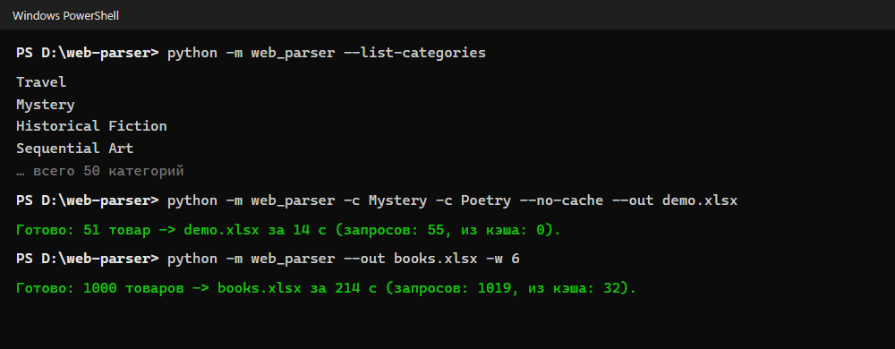
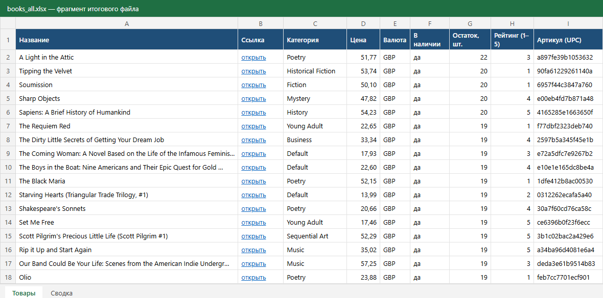
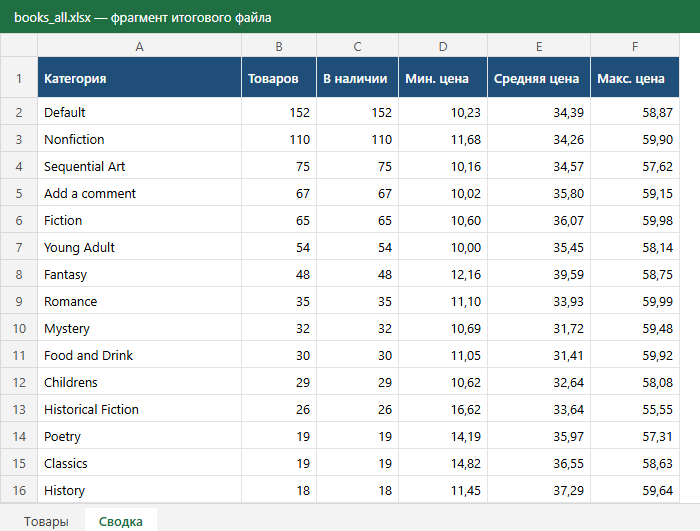

# web-parser — выгрузка каталога сайта в Excel

[](https://github.com/ZniKDK/web-parser/actions/workflows/tests.yml)


Парсер интернет-магазина: обходит каталог со всеми страницами, открывает карточку каждого товара и сохраняет данные в Excel, CSV или Google Таблицу.

В демо — [books.toscrape.com](https://books.toscrape.com/), открытая песочница для тренировки парсинга: 1000 книг в 50 категориях. Весь каталог выгружается примерно за 3,5 минуты. Столько времени занимает вежливая пауза между запросами, чтобы не нагружать сайт.



## Что получается на выходе

**Лист «Товары»:** название, ссылка, категория, цена, валюта, наличие и остаток, рейтинг, артикул, описание, фото. Шапка закреплена, есть фильтры, ссылки кликабельные, цены записаны числами, поэтому по ним работают сортировка и формулы.



**Лист «Сводка»:** сколько товаров в каждой категории, сколько в наличии, минимальная, средняя и максимальная цена. Внизу — источник и дата выгрузки.



**Лист «Ошибки»** появляется, если какие-то карточки не открылись или сайт изменил вёрстку. Сразу видно, что пропущено и почему. Один сбой не останавливает всю выгрузку.

*Картинки — фрагменты реального файла, отрисованные из его ячеек.*

## Возможности

- **Обход каталога:** пагинация, одна или несколько категорий, лимит товаров для пробного запуска.
- **Параллельная загрузка** карточек в несколько потоков. Порядок товаров в файле совпадает с каталогом.
- **Бережно к сайту:** общая пауза между запросами на все потоки, проверка `robots.txt`, честный User-Agent.
- **Устойчивость:** повторы при сбоях сети и ошибках 429/5xx с нарастающей паузой. 404 повторять не будет, а зацикленную пагинацию распознает.
- **Кэш страниц:** повторный запуск не скачивает сайт заново, удобно при настройке выгрузки.
- **Кодировки:** если сайт не указал кодировку, парсер определяет её сам, поэтому кириллица не превращается в «кракозябры».
- **Цены в любом формате:** `£51.77`, `1 234,50 ₽`, `1.234,50 €`, `$1,234.50`.
- **Выгрузка:** Excel с оформлением, CSV для Excel (UTF-8 с BOM, разделитель `;`), Google Таблица через сервисный аккаунт.

## Быстрый старт

Нужен Python 3.11+. Команды для Windows (PowerShell):

```powershell
git clone https://github.com/ZniKDK/web-parser.git
cd web-parser
python -m venv .venv
.venv\Scripts\activate
pip install -r requirements.txt

python -m web_parser --list-categories                  # список категорий
python -m web_parser --category Travel --out travel.xlsx # одна категория
python -m web_parser -c Travel -c Poetry --out books.csv # несколько категорий в CSV
python -m web_parser --limit 50 --out sample.xlsx        # пробные 50 товаров
python -m web_parser --out books.xlsx                    # весь каталог
```

На Linux и macOS: `source .venv/bin/activate`.

### Параметры

| Параметр | Что делает | По умолчанию |
|---|---|---|
| `-c`, `--category` | категория; можно указать несколько раз | весь каталог |
| `-n`, `--limit` | не больше N товаров | без лимита |
| `-o`, `--out` | файл результата `.xlsx` или `.csv` | `products.xlsx` |
| `-w`, `--workers` | число потоков | 4 |
| `--delay` | пауза между запросами, секунд | 0.2 |
| `--retries` | повторов при ошибке | 3 |
| `--no-cache` | скачать всё заново | кэш в `.cache/` |
| `--ignore-robots` | не проверять `robots.txt` | проверять |
| `--sheet-id`, `--credentials` | дополнительно записать в Google Таблицу | — |
| `-v` | подробный журнал | — |

### Google Таблица

1. В Google Cloud создайте сервисный аккаунт и скачайте ключ в формате JSON.
2. Откройте доступ к таблице на почту сервисного аккаунта (роль «Редактор»).
3. Установите `pip install gspread` и запустите:

```powershell
python -m web_parser -c Travel --out travel.xlsx --sheet-id <ID из адреса таблицы> --credentials key.json
```

### Запуск по расписанию

Если выгрузка нужна каждый день, создайте задачу в Планировщике заданий Windows. Действие: `путь\.venv\Scripts\python.exe`, аргументы: `-m web_parser --out C:\Выгрузки\catalog.xlsx --no-cache`, рабочая папка: папка проекта. На Linux то же самое делается через `cron`.

## Как подключить другой сайт

Загрузка, повторы, потоки и выгрузка уже лежат в ядре. Под новый сайт нужен только адаптер: класс, который знает, где на странице нужные данные. Обычно это 50–100 строк.

```python
# web_parser/sites/myshop.py
from web_parser.sites.base import SiteAdapter

class MyShop(SiteAdapter):
    name = "myshop"
    start_url = "https://myshop.example/catalog/"

    def categories(self, html, base_url): ...     # {название: ссылка}
    def product_links(self, html, base_url): ...  # ссылки на карточки со страницы списка
    def next_page(self, html, base_url): ...      # следующая страница или None
    def product(self, html, url): ...             # Product(title=..., price=..., ...)
```

Затем добавьте класс в `ADAPTERS` в `web_parser/sites/__init__.py` и запускайте с `--site myshop`. Для примера смотрите [books.py](web_parser/sites/books.py).

Сайтам, которые строят каталог в браузере через JavaScript, нужна загрузка через Playwright. Её можно подключить в `Fetcher`, а адаптер останется прежним.

## Структура

```
web_parser/
├── cli.py          # командная строка
├── fetcher.py      # загрузка: повторы, пауза, robots.txt, кэш, кодировки
├── scraper.py      # обход пагинации и параллельный разбор карточек
├── export.py       # Excel, CSV, Google Таблица
├── models.py       # модель товара и названия столбцов
└── sites/
    ├── base.py     # интерфейс адаптера
    └── books.py    # адаптер books.toscrape.com
tests/              # 49 тестов на сохранённых страницах, без интернета
```

## Тесты

```powershell
pip install -r requirements-dev.txt
pytest
```

Тесты работают на сохранённых HTML-страницах и подменённой сети. Проверяются разбор карточек и цен, пагинация и защита от зацикливания, повторы и `robots.txt`, кэш, обработка ошибок, структура Excel и CSV, командная строка. CI гоняет их на Ubuntu (Python 3.11 и 3.13) и Windows.

## Важно

Перед парсингом чужого сайта прочитайте его правила и `robots.txt`, не ставьте слишком маленькую паузу и не собирайте персональные данные.

## Лицензия

MIT
